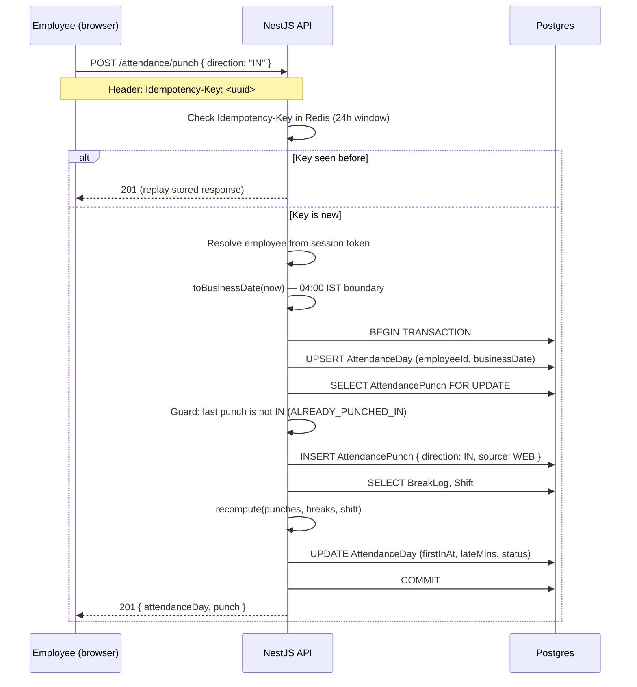
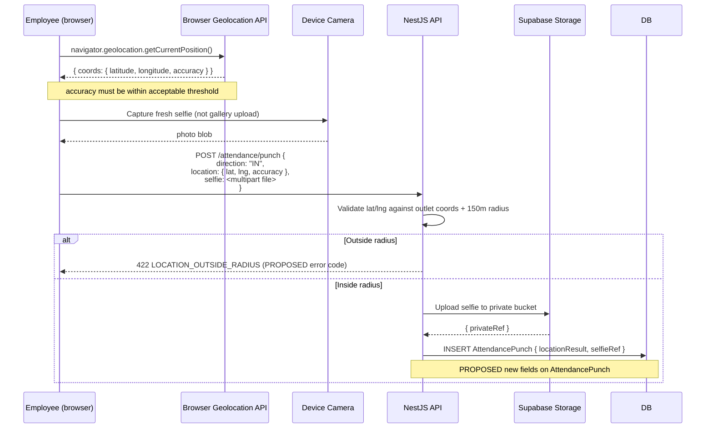
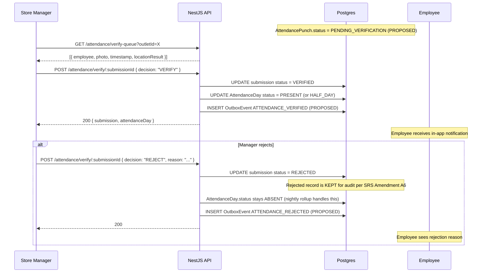
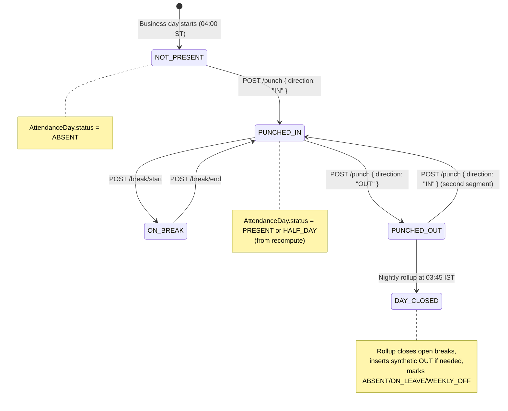
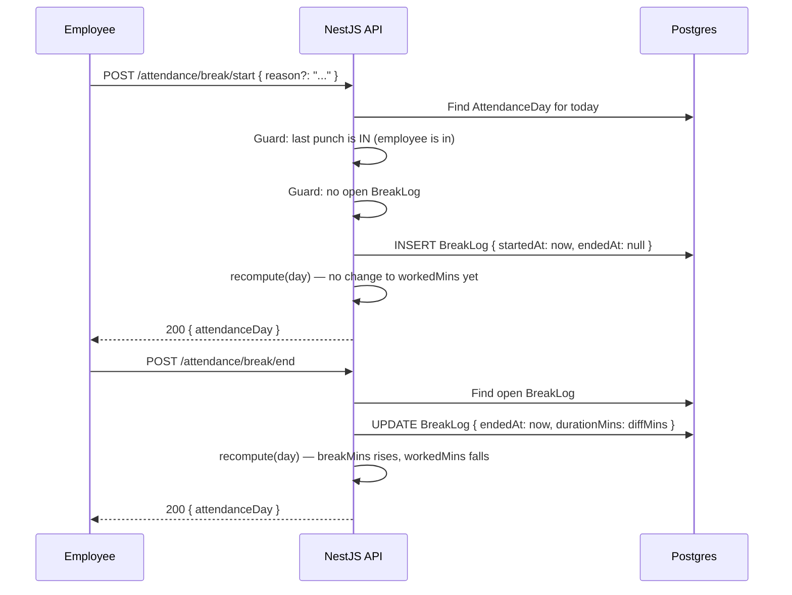
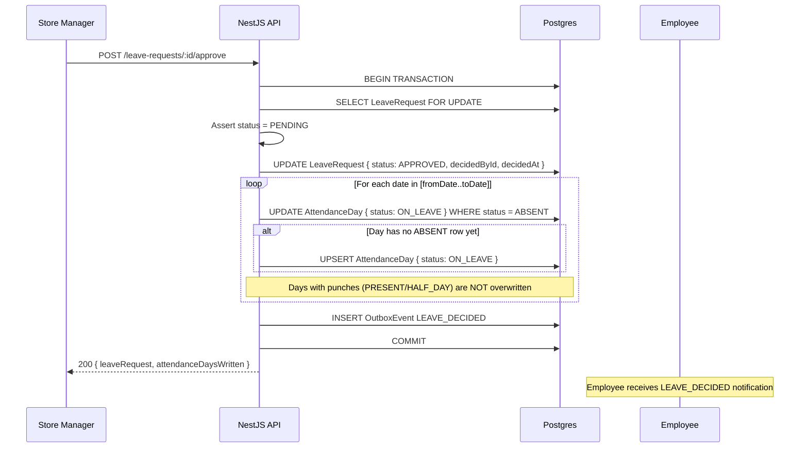

# Attendance System — Workflows

All workflows reference the codebase state on the `preview` branch as of 26 October
2026. Unimplemented flows are labelled clearly.

---

## Workflow 1: Employee attendance submission (check-in)

**Endpoint:** `POST /api/v1/attendance/punch`
**Source:** `apps\api\src\modules\workforce\attendance.service.ts` — `punch()`

### Happy path



### Alternative paths

- **Manager punching on behalf of staff**: supply `employeeId` and optionally `at` in
  the request body. Requires `workforce.attendance.edit`. Sets `source = MANAGER_EDIT`,
  `editedById = user.sub`. Writes an `AuditLog` row.
- **Second IN with same Idempotency-Key**: interceptor replays the stored 201 —
  employee sees success without creating a second punch.

### Failure cases

| Condition | Response |
|---|---|
| No `Idempotency-Key` header | 400 `ATTENDANCE_IDEMPOTENCY_KEY_REQUIRED` (per book ch.18; code constant is `ERROR_CODES.ATTENDANCE_*`) |
| `direction = IN` and last punch is also `IN` | 409 `ATTENDANCE_ALREADY_PUNCHED_IN` |
| Employee not found or outside scope | 404 `EMPLOYEE_NOT_FOUND` |
| Employee status is `EXITED` | 422 `EMPLOYEE_NOT_ACTIVE` |

---

## Workflow 2: Location and selfie validation

> ⚠️ PROPOSED — not yet implemented in source code. Required by SRS Amendment v1.1,
> sections A5 and A9. No geofence fields exist on the `Outlet` model in
> `schema.prisma`; no selfie upload logic exists anywhere in the codebase.

### Proposed flow (SRS Amendment v1.1, section A5)



### Required schema changes (PROPOSED — not approved for implementation)

The following fields do not exist and must be designed and approved before development:

- `Outlet.latitude`, `Outlet.longitude` — outlet coordinates for server-side validation
- `AttendancePunch.latitude`, `AttendancePunch.longitude`, `AttendancePunch.locationAccuracy` — submitted location evidence
- `AttendancePunch.locationResult` — enum: `INSIDE_RADIUS | OUTSIDE_RADIUS | LOW_ACCURACY | UNAVAILABLE`
- `AttendancePunch.selfieRef` — private storage reference or URL
- `AttendancePunch.verificationStatus` — or a separate `AttendanceSubmission` table

---

## Workflow 3: Manager verification and rejection

> ⚠️ PROPOSED — the verification queue and decision endpoints do not exist in the
> current codebase. The `AttendanceDay` model has no `verificationStatus` field.

### Proposed flow (SRS Amendment v1.1, section A5, steps 8–11)



---

## Workflow 4: Check-in / Check-out lifecycle

**Source:** `attendance.service.ts` — `punch()`, `recompute()`



### Rules verified in code

- An `IN` after an `IN` is rejected: 409 `ATTENDANCE_ALREADY_PUNCHED_IN`
- An `OUT` without a preceding `IN` is rejected: 409 `ATTENDANCE_NOT_PUNCHED_IN`
- Multiple IN/OUT pairs per day are allowed (split shifts)
- Business day boundary: 04:00 IST (`toBusinessDate()` in `@bobs-momo/shared`)
- Server clock is always used for `punchedAt`; client-supplied timestamps are only
  accepted from managers with `workforce.attendance.edit` and require a `reason`

---

## Workflow 5: Break logging

**Source:** `attendance.service.ts` — `startBreak()`, `endBreak()`

### Happy path



### Failure cases

| Condition | Response |
|---|---|
| Break start while not punched in | 409 `ATTENDANCE_NOT_PUNCHED_IN` |
| Second break start while one is open | 409 `ATTENDANCE_BREAK_ALREADY_OPEN` |
| Break end with no open break | 409 `ATTENDANCE_BREAK_NOT_OPEN` |

### Nightly rollup behaviour

If a break is still open at 03:45 IST, the rollup closes it:
- `endedAt = day.lastOutAt` (if there is a punch-out)
- `endedAt = shift.endsAt` (if no punch-out but a shift exists)
- `endedAt = startedAt` (if neither exists — zero duration)

---

## Workflow 6: Attendance history and percentage calculation

**Endpoints:** `GET /attendance`, `GET /attendance/summary`
**Source:** `attendance.service.ts` — `list()`

### History query

```
GET /attendance?from=2026-10-01&to=2026-10-26&outletId=X&employeeId=Y
```

- Self-scoped users have `employeeId` forced to their own id
- Date range limited to 92 days per query (see `attendanceHistoryQuery` in book ch.18)
- Returns `AttendanceDay` rows with employee info, but NOT the raw punches

### Attendance percentage calculation (from SRS Amendment v1.1, section A7)

```
Eligible Days = Scheduled Working Days − Approved Leave Days − Other Non-working Days
Attendance % = (Verified Present Days ÷ Eligible Days) × 100
```

> ⚠️ PROPOSED — The 365-day rolling analytics endpoint described in Amendment v1.1
> (section A7) is NOT YET IMPLEMENTED. There is no endpoint returning:
> - Rolling 365-day window
> - Eligible days calculation
> - Monthly trend
> - Pending/rejected submission counts
>
> The current `GET /attendance/summary` returns monthly figures per employee (per
> book ch.18) but does not implement the amendment's analytics requirements.

**Key rules (from Amendment v1.1):**
- Only verified present days count as present (pending does not)
- Approved leave reduces eligible days only on scheduled working days
- Pending/rejected leave does NOT reduce eligible days
- Future scheduled days are NOT absences
- If eligible days = 0, display "N/A" not 0%
- Prevent duplicate submissions from inflating present-day totals

---

## Workflow 7: Leave and attendance interaction

**Source:** `leave.service.ts` — `decide()`, `writeLeaveDays()`, `cancel()`

### Leave approval → attendance update (one transaction)



### Leave cancellation → attendance rollback

When a manager cancels a future APPROVED leave:
- `AttendanceDay` rows with `status = ON_LEAVE` for that employee in the date range
  are set back to `ABSENT`
- If dates are in the future, the nightly rollup will re-evaluate them correctly

**Half-day approval** does NOT write `ON_LEAVE`. The day's status comes from the
punch recompute. Only a note referencing the leave ID is written to the day row.

---

## Workflow 8: Error and retry handling

| Scenario | Current handling |
|---|---|
| Network timeout on punch | Idempotency-Key: client retries with same key, interceptor replays stored 201 |
| Double-tap on the punch button | Same Idempotency-Key from the same attempt; replay wins |
| Staff member never punches out | Rollup at 03:45 inserts a `SYSTEM_ROLLUP` OUT; day is flagged in `AttendanceDay.note` |
| Break left open overnight | Rollup closes it at `lastOutAt` or shift end |
| Location permission denied | PROPOSED: clear recoverable error shown; employee cannot submit without location |
| Camera permission denied | PROPOSED: clear recoverable error shown; employee cannot submit without selfie |
| Selfie upload failure | PROPOSED: must not show false success; retry the upload only, not create a duplicate record |
| Manager verifies a record employee has already had verified | PROPOSED: idempotency check on verification |
