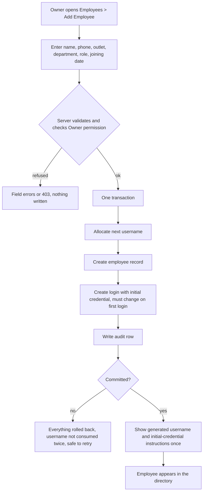
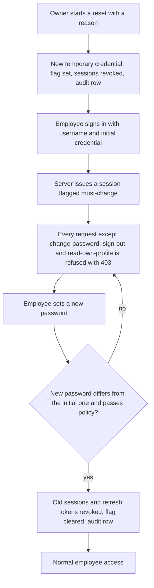
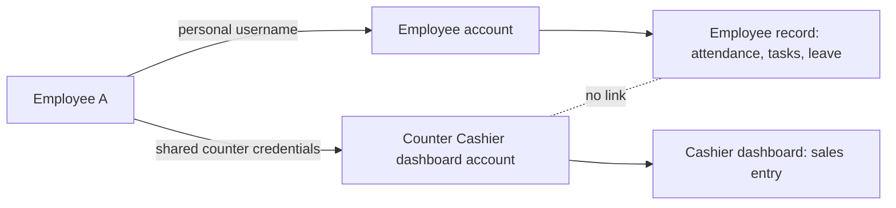

# Employee identity and dashboard accounts: analysis for Amendment 1.2

**Status: DRAFT amendment, implemented and tested on an isolated database
(27 October 2026). Not deployed.** Sections 1 to 12 were written before any code
changed and describe the system **as it was**, which is why they say things like
"not implemented". **Section 13 records what was built, what was assumed, and where
the build differs from the amendment, and supersedes sections 2, 4 and 10 wherever
they disagree.** The only access to live data was one read-only query (section 3);
the migration in section 13.6 has **not** been applied to the live database.

This is the supporting analysis for **SRS Amendment Version 1.2 (draft)**, appended
to `book/docs/BOBS CRM SRS.docx` as sections B1 to B15. The amendment holds the
normative requirements (`FR-IDN-001` to `FR-IDN-060`), the 20 acceptance criteria
(`AC-01` to `AC-20`) and the open decisions A to G. This document holds the
evidence: what the system does today, how that differs from the amendment, the
audit of existing accounts, and what would have to change later.

## 1. Documents and code inspected

| Source | Used for |
|---|---|
| `book/docs/BOBS CRM SRS.docx` (v1.0 and Amendment 1.1) | FR-AUTH-001..003, FR-EMP-001, section 5 roles, section 17 entities, A2/A3/A4/A5 |
| `book/docs/BOBS CRM FEATURE LIST.docx` | Sections 2.1 to 2.3 (roles, outlet restrictions, user and employee profiles) |
| `book/src/13-authentication.md` | Credential model, password policy, admin reset, first login |
| `book/src/18-employees-attendance-shifts.md` | Employee record, `userId` rules, employee code, `createEmployeeBody` |
| `book/src/37-security.md`, `10-data-model.md`, `05-glossary.md`, `27-screens-and-routes.md`, `04-decisions-register.md`, `42-open-questions.md` | Shared-login threat row, username rule, screens, decisions |
| `apps/api/src/modules/workforce/employees.service.ts` | Real employee creation, update, exit |
| `apps/api/src/modules/admin/users.service.ts`, `admin.controller.ts` | Real account creation, update, disable |
| `apps/api/src/modules/auth/` (`auth.service.ts`, `password.service.ts`, `auth.controller.ts`) | Password policy, temporary passwords, change, admin reset |
| `apps/api/src/common/guards/jwt-auth.guard.ts` | Server-side first-login enforcement |
| `packages/shared/src/admin.ts`, `workforce.ts` | Request schemas (`createUserSchema`, `updateUserSchema`, `createEmployeeSchema`) |
| `apps/api/prisma/schema.prisma`, `prisma/provision-initial-users.ts` | Models; how the live accounts were created |
| `apps/web/app/(auth)/`, `(app)/employees/`, `(app)/admin/users/` | Login, signup, change-password, employee and user screens |
| Live database (read-only, 27 Oct 2026) | Section 3 |

`book/src/14-rbac-and-permissions.md` was read but **deliberately not edited**: it is
the source from which `packages/shared/src/permissions.ts` is generated, and this
task may not touch RBAC sources. RBAC implications are recorded in section 6.

## 2. What the system does today (verified against code)

| Topic | Current behaviour | Evidence |
|---|---|---|
| Employee and login are separate rows | `Employee.userId` is nullable and unique; a login need not have an employee and an employee need not have a login. | `schema.prisma` Employee; book 18 |
| Employee creation | `POST /employees` creates **only** the employee row. It accepts an optional existing `userId`. There is **no `createLogin` option**, although book chapter 18 documents one. | `createEmployeeSchema` has no such field; `employees.service.ts` `create` |
| Account creation | A separate `POST /admin/users` (Admin, then Users, then New) creates the login with a **free-text username**, a role, outlets, and an optional `employeeId` to link. A random temporary password (`momo-7431-kite` style) is generated and returned once; `mustReset` is true. | `users.service.ts` `create`, `password.service.ts` `generateTemporary` |
| Two steps, not one | Creating an employee and creating a login are two separate requests. A crash or failure between them leaves an employee without a login, or a login without an employee. Nothing makes the pair all-or-nothing. | The two services above |
| Who may create | `workforce.employee.create` and `admin.user.create` are both held by **Owner and HR/Accounts** (all outlets). | RBAC matrix rows 147 and 196 |
| Username | Free text, lower-cased, 3 to 32 characters. **Editable** later through `PATCH /admin/users/:id`. | `usernameSchema`, `updateUserSchema` |
| Employee code | `BM-EMP-0007` style, a separate identifier from the username. Allocated by "highest existing code plus one", **not** by the database sequence that book 18 describes. Concurrent creation can collide on the unique index. | `employees.service.ts` `create` (`ORDER BY employeeCode DESC LIMIT 1`) |
| Initial password | Always a generated random passphrase, never a fixed value. `password1234` is not used anywhere. | `generateTemporary` |
| First-login change | Enforced on the **server**: `JwtAuthGuard` returns 403 `AUTH_PASSWORD_RESET_REQUIRED` for every route not marked `@AllowMustReset` (password change, logout, `/auth/me`). Book 13 names a separate `MustResetGuard`; in code the check is inside `JwtAuthGuard`. | `jwt-auth.guard.ts` |
| Password change | Requires the current password, refuses a new password equal to the current one, applies the policy, revokes all refresh tokens, audits `auth.password.change`. | `auth.service.ts` `changePassword` |
| Password policy | Minimum 10 characters, a letter and a number or symbol, must not contain the username, must not be in a small deny list. The deny list is an **exact-match** set of 14 entries and does **not** contain `password1234`. | `password.service.ts` `DENY_LIST` |
| Admin reset | `POST /auth/admin/reset-password` generates a new temporary password, sets `mustReset`, revokes sessions, audits with the reason; the password is returned once and never stored in plaintext. Held by **Owner, Operations Manager, HR/Accounts (all outlets) and Store Manager (own outlet)**. | `auth.service.ts` `adminReset`; RBAC row 141 |
| Audit of employee changes | Employee **exit** writes an audit row. Employee **create** and **update** do **not**. Account create, update, status change, role change and outlet change each write one (`admin.user.create`, `.update`, `.status_change`, `.role_change`, `.outlet_change`). | `employees.service.ts` (one audit call); `users.service.ts` |
| Login | One page, `/login`, for everyone. It redirects to `/change-password` when `mustReset`, otherwise to `/dashboard`. There is no separate employee login or employee dashboard route. | `(auth)/login/page.tsx` |
| Self-registration | None. `/signup` is an information page that says a manager creates the login. | `(auth)/signup/page.tsx` |
| Attendance eligibility | The live board is built from `Employee` rows with `status = ACTIVE` in the caller's outlets. A self punch is refused only for `EXITED`. A login without an employee row cannot punch (it is refused as "not linked to an employee record"). | `attendance.service.ts` `today`, `resolveEmployee` |
| Task eligibility | A task assignee and creator are `Employee` rows. Assignment is allowed for `ACTIVE` **and `ON_NOTICE`**. A login with no employee row cannot be an assignee or create a task. | `Task.assigneeId`, `createdById` -> `Employee`; `tasks.service.ts` `ASSIGNABLE` |
| **Three different eligibility rules** | Board and performance analytics: `ACTIVE` only. Self punch: anything except `EXITED` (so `ON_NOTICE` can punch but is missing from the board). Task assignment: `ACTIVE` and `ON_NOTICE`. The amendment requires one rule applied everywhere (FR-IDN-051, 052). | `attendance.service.ts`, `analytics.service.ts`, `tasks.service.ts` |
| Other places that treat every active `Employee` as a person | Employee performance analytics; the employee directory and its counts; message recipient lists; roster and task dropdowns. | `analytics.service.ts` (employee query), `employees.service.ts`, `messaging.service.ts`, `listEmployees` callers |
| Shared logins in the threat model | Book 37 lists "a shared login" as a risk, mitigated by "one user per employee". | `book/src/37-security.md` |

**Consequence.** Because eligibility today is simply "has an active `Employee` row",
the way to keep a dashboard-only account out of attendance, tasks and counts is for
that account to have **no** `Employee` row. That model is already representable
without a new column. The problem is not the schema; it is that existing accounts
were created *with* employee rows (section 3).

## 3. Audit of existing accounts (read-only, 27 October 2026)

One read-only query against the live database listed every login and its employee
link. No passwords, hashes or tokens were read, and nothing was changed.

| Username | Role | Outlet scope | Employee row | Must reset | Ever logged in |
|---|---|---|---|---|---|
| owner | OWNER | all | BM-EMP-0001 | no | yes |
| operations.manager | OPERATIONS_MANAGER | all | BM-EMP-0002 | no | yes |
| store.manager.saheed | STORE_MANAGER | Kalinga Nagar | BM-EMP-0003 | yes | no |
| store.manager.patharagadia | STORE_MANAGER | Pathargadia | BM-EMP-0004 | yes | no |
| kitchen.manager.saheed | KITCHEN_MANAGER | Kalinga Nagar | BM-EMP-0005 | yes | no |
| kitchen.manager.patharagadia | KITCHEN_MANAGER | Pathargadia | BM-EMP-0006 | yes | no |
| inventory.manager | INVENTORY_MANAGER | both | BM-EMP-0007 | yes | no |
| purchase.manager | PURCHASE_MANAGER | both | BM-EMP-0008 | yes | no |
| hr.accounts | HR_ACCOUNTS | both | BM-EMP-0009 | yes | no |
| kitchen.staff.saheed | KITCHEN_STAFF | Kalinga Nagar | BM-EMP-0010 | yes | no |
| kitchen.staff.patharagadia | KITCHEN_STAFF | Pathargadia | BM-EMP-0011 | yes | no |
| counter.cashier.saheed | COUNTER_CASHIER | Kalinga Nagar | BM-EMP-0012 | yes | no |
| counter.cashier.patharagadia | COUNTER_CASHIER | Pathargadia | BM-EMP-0013 | yes | no |

Totals: **13 logins, 14 employee rows (one employee has no login), 1 attendance
day, 0 tasks.**

Findings:

1. **Every role-named login has its own employee row**, including both
   `counter.cashier.*` accounts. `prisma/provision-initial-users.ts` creates a login
   and an employee together for each of its 13 entries and gives them the same
   temporary password. So the shared-account problem the amendment describes is
   already in the data: those cashier "employees" appear on the attendance board,
   in the employee directory and in employee counts.
2. Each of those employee rows has a placeholder name, so none of them is a real,
   identified person.
3. **12 of 13 logins have never been used.** Only `owner` and `operations.manager`
   have signed in, so reclassification would currently affect almost no one's
   working habits. That is an opportunity, not permission to act.
4. The usernames `*.saheed` are stale: that outlet is now Kalinga Nagar. The
   usernames carry an outlet name, which the amendment's username rule forbids for
   new accounts.
5. One attendance day exists and no tasks, so there is almost no history to
   preserve. This should be re-checked before any change.
6. The 14th employee row has no login. It may be a real person or a leftover.

**Candidate classification (not applied; needs the Owner, decision C).**

| Class | Candidates from the data above |
|---|---|
| Operational or shared dashboard account (should have no employee row) | `counter.cashier.*`, and possibly `kitchen.staff.*` and the manager role accounts if they are shared |
| Individual person with an administrative login (keeps an employee row, may need an individual employee account too) | `owner`, `operations.manager`, `hr.accounts`, and any manager who is a named person |
| Real employee with no login | the unlinked 14th row, and anyone later added without a login |

Nothing here says which accounts are shared and which are one person's; only the
business can say. No deletion, merge, reassignment or relinking should be done
before that answer.

## 4. Specification versus the system as built

| Requirement | As built | Gap | Eventual change area |
|---|---|---|---|
| FR-IDN-010 Owner creates employees | HR/Accounts may also create employees and logins | Authority wider than specified (decision E) | Permission grant, Owner Dashboard screen |
| FR-IDN-011 no editable username | Username is typed on the account form and editable afterwards | Contradicts both parts | Account create and update schemas, forms |
| FR-IDN-013 all-or-nothing creation | Employee and login are two requests | No atomic operation; orphans possible | One server operation in one transaction |
| FR-IDN-020 to 025 generated `BMEMP####` | Free-text usernames; employee code is a different identifier | Not implemented; case rule conflicts (see below) | Allocation mechanism, schema |
| FR-IDN-021 concurrency-safe | Employee code uses highest-plus-one, which can collide | Existing code also vulnerable | Allocation mechanism |
| FR-IDN-030 to 034 initial credential | Random temporary password; no fixed default | The requested `password1234` does not exist; it is also absent from the deny list | Credential policy (decision A), deny list |
| FR-IDN-032 mandatory first change | Enforced server-side | **Already met** | None |
| FR-IDN-042 no password retrieval | Hash never leaves the service layer | **Already met** | None |
| FR-IDN-043 Owner reset | Exists, with sessions revoked and audit | Held by four roles (decision E) | Permission grant |
| FR-IDN-045 audit of employee create and update | Only exit is audited | Missing audit rows | Employee service |
| FR-IDN-050 to 052 eligibility | By employee row; 13 role-named accounts have rows | Data, not code (section 3) | Reclassification after approval |
| FR-IDN-060 identity from session | Already derived from the token | **Already met** for attendance and leave; verify for new endpoints | Tests |
| B9 separate entry points | One `/login` | Decision G | Routing |

**The case conflict.** The existing username rule lower-cases everything. The
requested `BMEMP0001` is upper case. Either usernames are stored as `bmemp0001` and
displayed as `BMEMP0001`, or the rule changes. A login lookup must then match
regardless of how the employee types it. This is part of decision B.

**Two numbers, two purposes.** `BM-EMP-0007` is the human-facing employee code
printed on rosters and CSV imports. `BMEMP0007` would be the login name. If both
are kept, the two numbers can be allocated independently and drift apart, or be
deliberately kept equal; that is decision B and should be chosen, not left to
happen.

## 5. Workflows

### 5.1 Owner creates an employee (required behaviour)

### 5.2 What each failure must leave behind

| Failure point | Required state afterwards |
|---|---|
| Validation fails | No row of any kind |
| Not the Owner | No row, 403 |
| Username allocation fails | No employee, no login |
| Employee row fails | No login, no audit |
| Login row fails | No employee row |
| Audit write fails | Nothing committed (same transaction) |
| Response lost after commit | One employee and one login exist; a retry with the same request key returns the same result, not a second employee |
| Two Owners submit at once | Two employees, two different usernames |
| Sequence value used by a rolled-back attempt | May leave a gap; must never be reissued |

### 5.3 First login and reset

### 5.4 Two identities for one person

## 6. RBAC implications (recorded, not edited)

| Need | Today | Future change (after decisions E, F) |
|---|---|---|
| Owner-only employee creation | `workforce.employee.create` and `admin.user.create`: Owner and HR | Possibly remove HR; or add a single combined permission |
| Owner-only reset of employee accounts | `auth.password.reset_other`: Owner, Operations Manager, HR (all), Store Manager (own outlet) | Possibly narrow |
| Username not editable | `admin.user.update` allows username change | Schema change, not a permission |
| Dashboard-only account has no employee privileges | Already true: self-service permissions require an employee row | Tests only |
| Role of an employee account | All nine roles include punch, break and leave self-service | Decision F: reuse an existing role or define a self-service role |

Any change has to be made in the matrix in `book/src/14-rbac-and-permissions.md`
and regenerated, as the generator header requires; it is therefore left for the
implementation phase.

## 7. Eligibility, as a rule

An employee record is **eligible** for attendance, tasks and employee reporting when
it exists, has an approved employment status, and belongs to an outlet in the
caller's scope. It does **not** depend on the role of any login linked to it.

Which statuses count is **not yet decided and is not the same today everywhere**
(section 2): the board and analytics use `ACTIVE` only, task assignment uses `ACTIVE`
and `ON_NOTICE`, and self-punching refuses only `EXITED`. A person serving their
notice period is the practical case. The Owner should confirm one rule (added to
decision E); `EXITED` is clearly ineligible and `ACTIVE` clearly eligible. A dashboard-only
account has no employee record, so it is never eligible. This matches how the system
already treats a login with no employee row, and needs no new field unless the
Owner wants dashboard accounts to keep employee rows for another reason.

## 8. Requirements that cannot be settled from the documents

See amendment section B13. In brief:

| Decision | Why it cannot be settled here |
|---|---|
| A. Initial password | `password1234` was requested; unique passwords are safer; only the Owner can choose. Also not on the deny list today. |
| B. Username convention | Case rule conflicts; relationship to the employee code is undefined |
| C. Existing accounts | Only the business knows which accounts are shared people |
| D. Shared accountability | No cashier shift or operator workflow exists in the SRS |
| E. Owner scope | FR-EMP-001 names HR; several roles can reset passwords today |
| F. Role of an employee account | Not defined; may need a new role |
| G. Entry points | One page today; A4 only proposes `/employee/login` |

## 9. Documentation corrections found

These existing statements are wrong or will be wrong once Amendment 1.2 is approved.
They are annotated in place (section 10) rather than rewritten.

1. Book 18: "Every human who touches this system gets an Employee row, the owner
   included." Not true for dashboard-only accounts under the amendment.
2. Book 18: `createEmployeeBody` with `createLogin`. Not implemented.
3. Book 18: employee code allocated from a database sequence. Implemented as
   highest-plus-one.
4. Book 13: `MustResetGuard`. Implemented inside `JwtAuthGuard`.
5. Book 37: shared logins are a threat mitigated by one user per employee. The
   amendment deliberately allows shared operational dashboard accounts, so the row
   needs qualifying, not deleting.
6. `/signup` says "your manager creates your login". The amendment says the Owner
   does, pending decision E.

## 10. Future change map (for planning only, nothing approved)

| Area | Items likely to change after approval |
|---|---|
| Database | Allocation mechanism for usernames (decision B); possibly a flag distinguishing dashboard accounts if the Owner wants one; no destructive change |
| API | One create-employee-with-login operation; stop accepting a client username; username immutable on update; audit rows for employee create and update; narrow create and reset permissions if decided |
| Auth | Deny-list entry for any approved shared default; employee entry point if decision G says so; first-login behaviour already present |
| Web | Employee directory and Add Employee form without a username field; generated username shown after creation; employee detail with reset; login entry points; employee dashboard landing |
| Data | Audited classification of the 13 accounts and the unlinked employee; migration only with approval |
| Tests | Concurrency of username allocation; atomicity; eligibility in attendance, tasks, counts and analytics; cashier login creates nothing |

## 11. Acceptance criteria

The 20 criteria are in amendment section B12. All are **Not Run** because nothing
is implemented. They are written so each can be turned into an automated test.

## 12. Remaining documentation gaps

- The Owner Dashboard does not yet exist as a named, separate screen set; the
  current employee and user screens sit under general navigation. Decision G and F
  will shape this.
- No document defines employee account deactivation versus exit versus login
  suspension as one lifecycle. Today an exit disables the login; suspension is a
  separate user status.
- The initial-credential delivery method (spoken, printed, messaged) is not
  defined; the current system shows it once to the creator. No messaging channel is
  approved for credentials.
- Rate limiting of the login endpoint is described in book 13; its actual
  configuration was not re-verified for this document.
- Which employee fields the Owner may edit is not specified (decision E).

---

## 13. Implementation (27 October 2026)

### 13.1 Scope

Built on the Owner's instruction, with the open decisions A to G still unanswered.
Where a decision was needed to build, the choice is listed in 13.3 and is meant to be
confirmed or changed. Nothing was deployed, no live record was changed, and the new
migration was applied only to isolated test databases.

### 13.2 What was built

| Capability | Where |
|---|---|
| One operation creates the employee, their individual login, a generated username, a generated employee code and two audit rows, all in one transaction | `apps/api/src/modules/workforce/employees.service.ts` `create` |
| Usernames `BMEMP0001`... from a database sequence, never from the request or from "highest plus one"; never reused; grows past four digits | migration `20261027000000_employee_identity` (`employee_username_seq`); `packages/shared/src/employee-identity.ts` |
| Employee codes from a database sequence (the old highest-plus-one could collide) | same migration (`employee_code_seq`, started after the highest existing code) |
| Initial password and mandatory first-login change | `password.service.ts` `initialEmployeePassword`; existing server-side `mustReset` check in `jwt-auth.guard.ts` (unchanged) |
| Employee sign-in that refuses accounts with no eligible employee record | `POST /auth/employee-login`; `auth.service.ts` `login(..., { employeeOnly })` |
| Per-address limit on failed sign-ins | `auth.service.ts`; `RedisService.incr`; `LOGIN_IP_FAILURE_LIMIT` |
| One eligibility rule for attendance, tasks and analytics | `isEligibleEmployee` in shared; `attendance.service.ts`, `tasks.service.ts`, `analytics.service.ts` |
| Owner can include or leave out an employee record without deleting anything | `eligibleForWorkflows` column; `POST /employees/:id/eligibility`; permission `workforce.employee.account` |
| Add Employee (no username field, role select, generated username and initial password shown once with copy), employee detail with account panel, confirmed password reset, eligibility control, notice-period status | `apps/web/app/(app)/employees/new`, `[id]`, `employees/page.tsx`, `features/workforce/*` |
| Employee sign-in page and the dashboard sign-in page (one shared view) | `features/auth/login-view.tsx`, `app/(auth)/employee/login`, `app/(auth)/login` |
| Employees with no dashboard role start on their attendance page; dashboard accounts land where they did | `lib/auth.tsx` `homePath` |

### 13.3 Assumptions made for open decisions

| Decision | What the build does | To change it |
|---|---|---|
| A. Initial password | `password1234` for every new employee, as requested. Mandatory change at first login; `password1234` added to the refused list so nobody can choose it; the new password must differ from the initial one. Risk accepted and recorded in 13.7. | One method, `initialEmployeePassword()`, in `password.service.ts`; the reset flow already issues a unique random passphrase |
| B. Case and numbering | Stored lower case (`bmemp0001`), shown upper case (`BMEMP0001`); typed in any case at sign-in. The username number and the employee-code number are separate sequences and can differ. | `formatEmployeeUsername`, `displayUsername` |
| E. Who creates employees | Owner only (`workforce.employee.create` narrowed from Owner and HR). Who may reset passwords is **not** narrowed (see 13.4). | RBAC matrix, then regenerate |
| E. Which statuses count as eligible | `ACTIVE` and `ON_NOTICE`, and the Owner's flag. Previously the board used `ACTIVE` only, task assignment used both, and punching refused only `EXITED`. | `ELIGIBLE_EMPLOYMENT_STATUSES` |
| F. Role of an employee account | Chosen at creation from every role except Owner. No new role was invented. | `createEmployeeSchema` |
| G. Entry points | Separate addresses: `/employee/login` and `/login`. | Routing only |
| C. Existing 13 accounts | **Not touched.** They remain employees and still appear on the board until the Owner leaves them out one by one with the new control. No script reclassifies anything. | Owner action per record |

### 13.4 Where the build differs from the amendment text

1. **FR-IDN-044 (reset is Owner-only) is not met.** `auth.password.reset_other` is
   still held by Owner, Operations Manager, HR/Accounts and Store Manager, because
   narrowing it would remove a manager's ability to reset their own staff and that
   is a business decision (E). The Owner UI uses the same endpoint.
2. **HR/Accounts can still link a login to an employee** through Admin, Users, New
   (`employeeId`). That path creates a dashboard-style account with a typed
   username; it cannot take a `BMEMP` name. It is kept for the legacy employee with
   no login. Whether to restrict it is decision E.
3. **Added beyond the amendment:** the `eligibleForWorkflows` column and permission
   `workforce.employee.account`; the per-address sign-in failure limit; changing
   an employee between Active and On Notice; actor recorded on employee exit (it
   was recorded as "system" before); audit rows for employee update and create.
4. **Role and outlet changes** for an employee's login are still done in Admin, Users
   (existing audited endpoints). The employee page edits the home outlet and
   department but does not change the login role.

### 13.5 API changes

| Endpoint | Change |
|---|---|
| `POST /employees` | Owner only. Requires an `Idempotency-Key`. Body gains required `roleKey`; `username`, `userId`, `password`, `mustReset` and unknown fields are refused (400). Returns `{ employee, account: { username, roleKey, mustReset, initialPassword } }`. |
| `PATCH /employees/:id` | Gains `status` (`ACTIVE` or `ON_NOTICE`). No longer accepts `userId`, `roleKey`, `joinedOn`, `username`. Audited with before and after. A leaver's status cannot be changed. |
| `POST /employees/:id/eligibility` | New. Owner only. `{ eligible, reason }`, reason required, audited. |
| `POST /auth/employee-login` | **Removed (22 November 2026).** One sign-in, `POST /auth/login`, serves employees and dashboard accounts; the redirect after sign-in depends on the account. |
| `GET /employees`, `/employees/:id` | Return `eligibleForWorkflows` and, for the login, `status`, `mustReset`, `lastLoginAt`. Search also matches the username. Never a password or hash. |
| `PATCH /admin/users/:id` | A generated `bmemp` username cannot be renamed (409). Typing a `bmemp` username for any account is refused (400). |
| Attendance, tasks, analytics | A record with `eligibleForWorkflows = false` takes no punches or breaks (409 `EMPLOYEE_NOT_ELIGIBLE`), is not assignable (422), and is left out of the board and employee performance. History is untouched. |

Permissions: 86 keys now (was 85). `workforce.employee.create` is Owner only;
`workforce.employee.account` is new and Owner only.

### 13.6 Database

Migration `20261027000000_employee_identity`, additive only: two sequences
(`employee_username_seq`, `employee_code_seq`, the latter started after the highest
existing code) and `Employee.eligibleForWorkflows boolean not null default true`.

- Applied to an isolated PostgreSQL 16 database from scratch: yes.
- Applied over a database shaped like the live one (14 employees, 13 role-named
  logins, an attendance day, a code `BM-EMP-0100` above the rest): yes. All rows
  intact, every existing employee still eligible, the code sequence resumed at 101,
  the username sequence at 1.
- **Applied to the live Supabase database: no.** It needs your authorization.
- Rollback is manual: drop the column and the two sequences. Dropping the column
  loses any Owner exclusions made since.

### 13.7 Security notes

- Passwords are stored only as argon2 hashes and never appear in any read, audit
  row, log or error. The initial password is returned once in the create response.
  **The create response is cached by the idempotency layer for 24 hours** so a retry
  can replay it; that cache therefore holds the initial password (a published
  value under policy A). If policy A changes to unique passwords, that cache needs
  to omit the password.
- **Shared initial password risk (decision A).** Usernames are sequential and the
  initial password is the same for everyone, so until a new employee signs in for the
  first time their account can be opened by anyone who knows the pattern. Mitigations
  built: a per-address limit of 20 failed sign-ins per 15 minutes (returns 429), the
  existing five-failure account lockout, the server-side forced change, and refusing
  the published password as a chosen one. These reduce, not remove, the risk: an
  attacker spreading attempts over many addresses is not stopped. The recommended
  fix is a unique temporary password per employee.
- The sign-in limiter and idempotency both fail open if Redis is unreachable.
- **Two requests with the same idempotency key arriving at the same instant** could
  both pass the replay check before either is stored; a sequential retry is safe.
- Unchanged and out of scope: a disabled account's access token works until it
  expires (up to 15 minutes).
- The sign-in page for employees answers a shared dashboard account, a wrong
  password and an unknown name identically.

### 13.8 Tests (isolated PostgreSQL 16 and Redis, never the live database)

| Check | Command | Result |
|---|---|---|
| Shared unit tests (username format, expansion, eligibility rule, request schemas, reserved names) | `bun test packages/shared` | **Passed**, 18 |
| Employee identity integration (34 tests: creation, Owner-only, forged fields, idempotency, 12-way concurrency, expansion, skipping a taken number, forced mid-transaction failure with real rollback, audit with no secrets, edits, rename refusal, reset and session revocation, first login, weak and default password refusal, employee sign-in separation, dashboard-account separation, two identities for one person, cross-employee isolation, eligibility across attendance, tasks and analytics, geofence intact) | `bun test test/employee-identity.e2e.test.ts` | **Passed**, 34 |
| Rate limit | `LOGIN_IP_FAILURE_LIMIT=5 bun test test/login-rate-limit.e2e.test.ts` | **Passed**, 3 (skipped in the normal run, by design) |
| Attendance, workforce, auth, tasks, analytics, RBAC coverage and the earlier unit tests | `bun test` on 9 files | **Passed**, 282 of 282 |
| Whole API suite, twice | `bun test test` | 394 passed, 5 skipped, **1 failed**, both runs. The failure is the existing low-stock digest notification test, which depends on the database and app clocks agreeing (see the attendance audit, S8); not related to this work. |
| Web unit tests | `bun test apps/web` | **Passed**, 25 |
| API typecheck, lint, build | `bun run typecheck`, `bun run lint`, `bun run build` in `apps/api` | **Passed** |
| Web typecheck and production build | in a clean copy of `apps/web` | **Passed** (59 pages, includes `/employee/login`) |
| Prisma schema | `bunx prisma validate` | **Passed** |
| Whole-repo lint (what CI runs) | `bun run lint` | **Failed**, 2 errors, both in `apps/web/features/inventory/receive-stock-flow.tsx`, not part of this work (pre-existing) |

An existing test hard-codes the Owner's permission count; it was updated from 84 to
85 because of the new Owner-only permission. The existing workforce test that created
an employee as HR now expects a refusal and creates it as the Owner.

Browser checks (real web app and API, isolated database; geolocation simulated):
Owner sign-in, Add Employee validation messages, creation showing the generated
username and initial password with no username input, directory and detail,
password reset (required reason, one-time display), eligibility control with
confirmation, the shared cashier account refused on the employee page with the same
message as a wrong password, the new employee forced to change password and refused
the published default, old initial and temporary passwords dead, landing on the
employee's own attendance page, a geofenced punch, and the shared account unable to
punch and still reaching its own dashboard. No page-level horizontal scroll at
344 px. A 280 px check was inconclusive (the emulator reported a different width).

### 13.9 Known limitations and not done

- Not tested on a real device, and not tested against the live database.
- The 13 existing role-named accounts are unchanged: still employees, still on the
  attendance board. The Owner must decide per account (decision C) and use the new
  control.
- Message recipient lists still use active employees; they were not part of the
  attendance, task or reporting rules and were left alone.
- `/signup` still says "your manager creates your login"; the build means the Owner.
- The employee page does not change a login's role or outlets (Admin, Users does).
- No cashier operator identification (decision D).

### 13.10 Readiness

**Ready for staging validation only. Not ready for deployment.** Remaining before
deployment: the Owner's answers on A, B, C, E, F and G; authorization to apply the
migration to the database; a real-device sign-in and punch test on a staging copy;
Redis available (the limiter and idempotency depend on it); synchronized clocks
between hosts; and the two unrelated lint errors fixed so CI passes.
